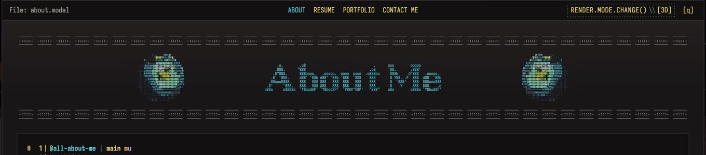
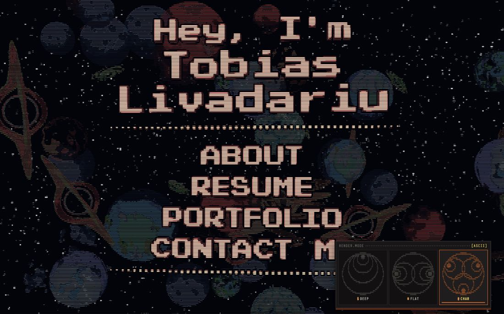
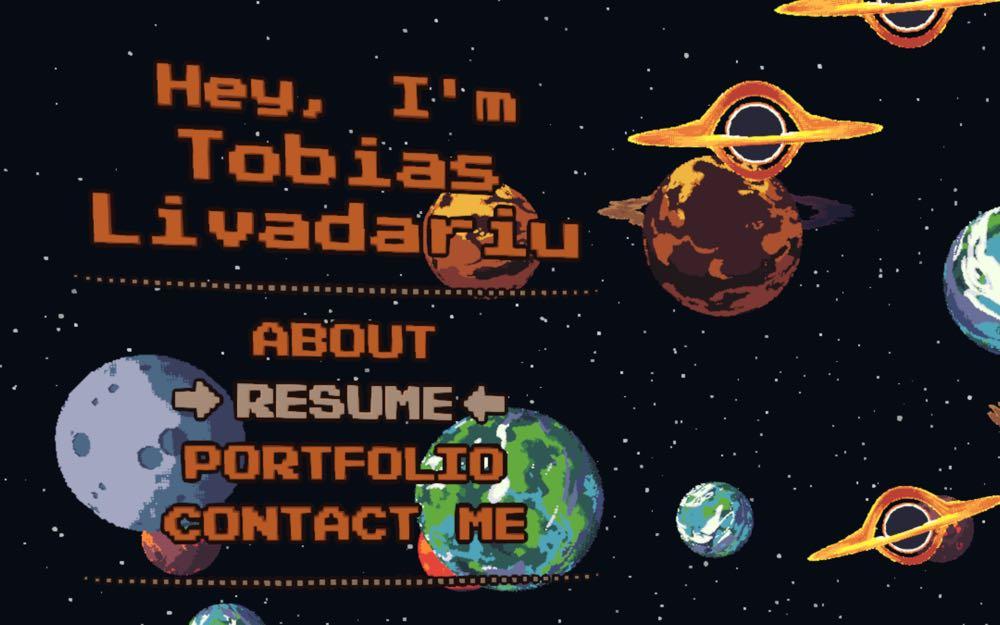
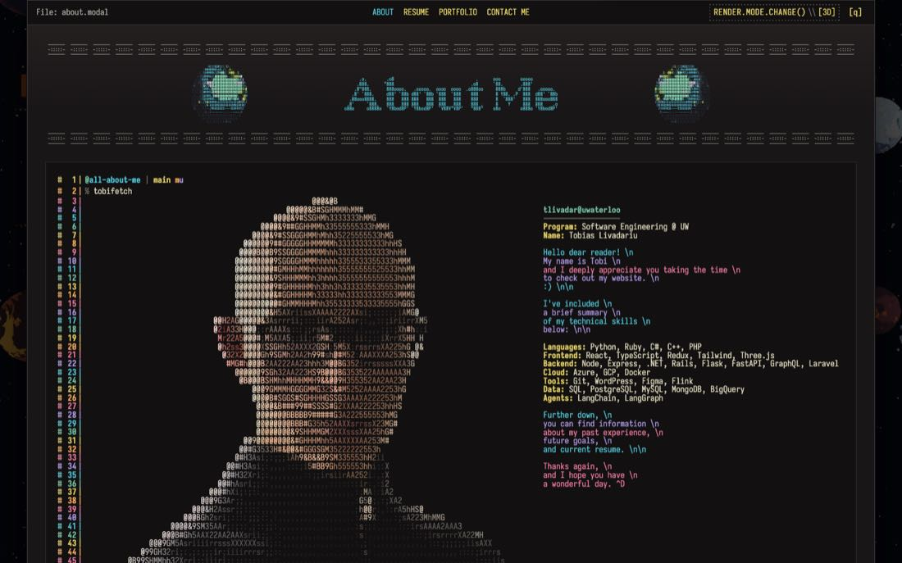
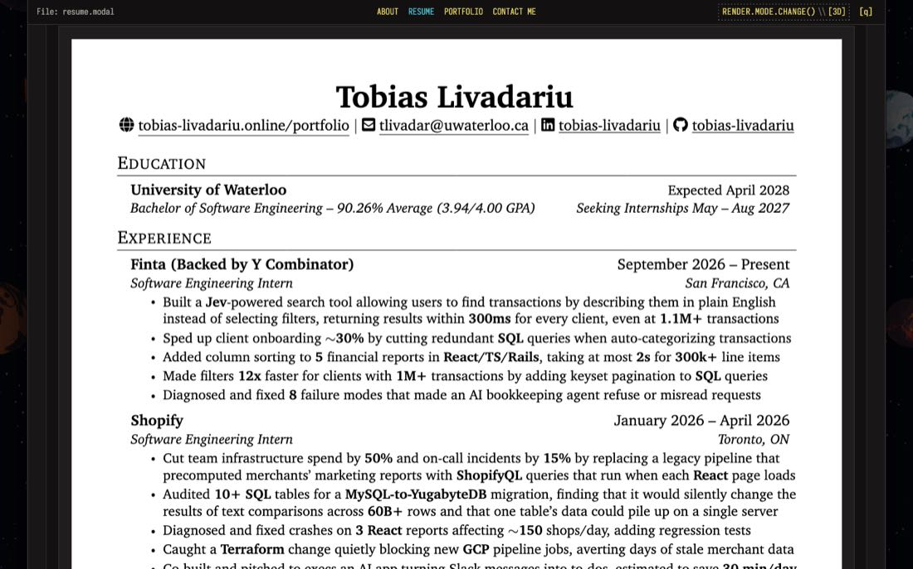
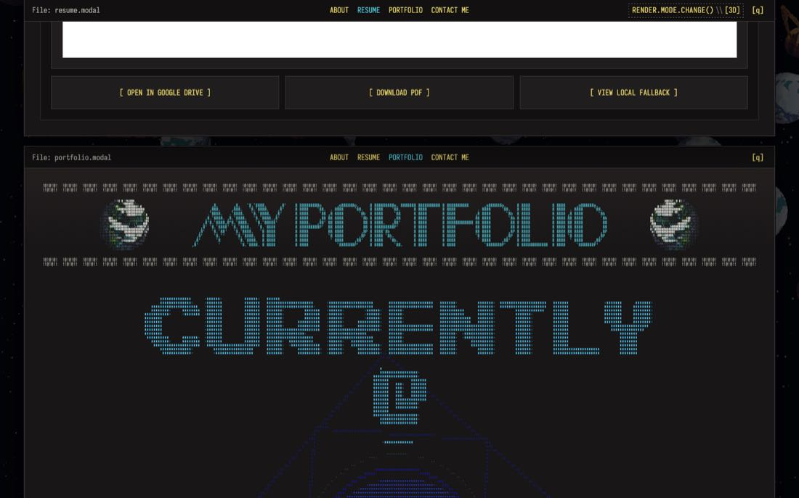
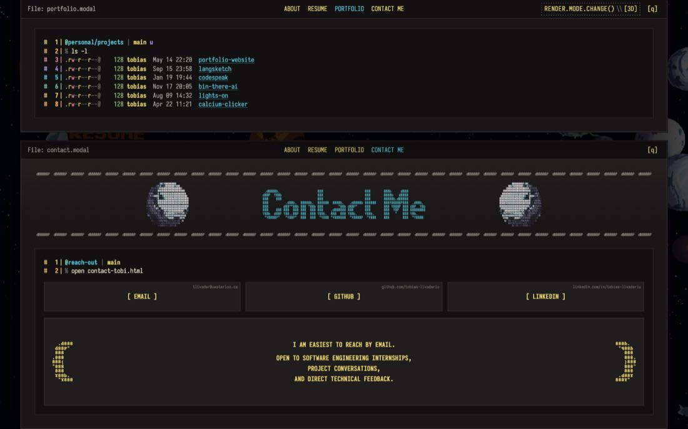
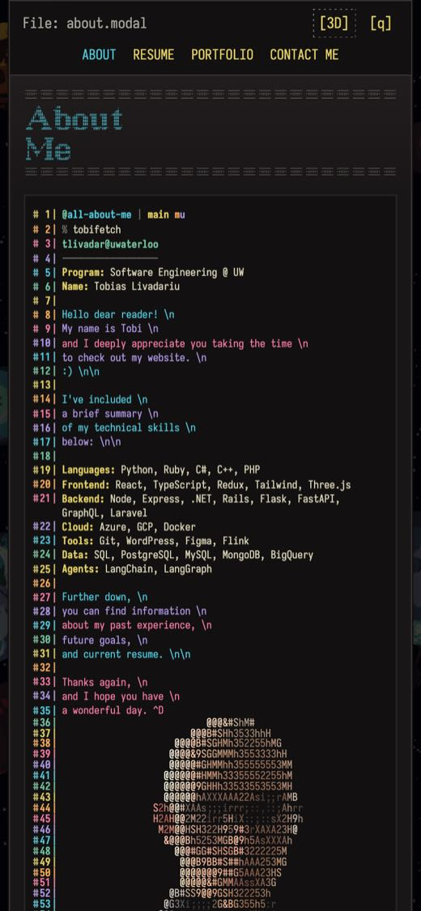

# portfolio-v3 design review: findings

Reviewed 2026-11-10 against the dev build at commit `3667826`.
The companion file [`IMPLEMENTATION_PROMPT.md`](./IMPLEMENTATION_PROMPT.md) is
a prompt you can hand to a coding agent to act on this.

## Verdict

The site does not need a redesign. The starfield, the three render modes, the
diamond transition, and the terminal documents are distinctive and well made,
and nothing here suggests replacing any of them.

The oversights are in five places:

1. **Hierarchy inside the documents.** The section titles are the smallest
   element on the page, and the About panel gives most of its height to the
   lower half of the portrait.
2. **Landing composition in two of the three modes.** In ASCII mode the render
   rail covers part of the menu at laptop sizes. In 3D mode planets drift
   directly behind the title.
3. **Content the design hides.** Your current employer is never named in
   visible text, your Hack the North win does not appear in the Portfolio
   section, and the About copy says little about you.
4. **Phones.** Body text is about 10px, section titles are about 3px, and the
   résumé preview cannot be read.
5. **A missing finishing layer.** Text selection, focus rings, hover states,
   scroll position, link previews, and reduced motion are all at browser
   defaults or absent.

The first three change how the site looks to every visitor. I would start
there.

## Status as of 2026-11-11

Tobias reviewed the findings below. This table records what was decided; the
sections themselves are left as originally written.

| Finding                     | Decision                                                                                                                      |
| --------------------------- | ----------------------------------------------------------------------------------------------------------------------------- |
| A1 section title scale      | Declined. The titles read fine in context.                                                                                    |
| A2 ASCII rail overlap       | Declined. Shrinking the ASCII menu to clear the rail would make that mode look worse, and the other modes show the full menu. |
| A3 planets behind the title | Declined as a legibility fix. Planet motion itself was reworked instead; see below.                                           |
| A4 About portrait and copy  | Declined. The portrait is the point of the panel.                                                                             |
| A5 résumé white page        | Open. A dark render using pdf.js `pageColors` is the leading option.                                                          |
| A6 Portfolio content        | Open.                                                                                                                         |
| A7 phone type size          | Open for body text. The unreadable résumé preview is accepted, since the buttons below it open the file.                      |
| B1 to B8                    | Open.                                                                                                                         |
| C1 to C5                    | Open.                                                                                                                         |
| Taste calls                 | All four declined. Leave them as they are.                                                                                    |

Built on branch `fable/planet-motion` (uncommitted):

- **Planet motion in 3D and ASCII.** Each planet now follows a Kepler ellipse
  with its well at one focus, timed by Kepler's equation, on an orbital plane
  tilted out of the screen so it approaches and recedes along its path. The
  ellipses precess slowly and asteroids ride comet-like eccentric orbits. 3D
  also gains a distance haze, and planets are no longer depth-tested against
  the star layer, so stars never draw on top of a planet that swings deep.
- **Moon systems, kept rare.** About one host in ten (a star, ringed giant,
  or black hole) holds one or two moons, on orbits sized to stay clear of
  the host's body so a moon is never hidden behind it. The first version
  turned about 85 of the 300 planets into moons on steep orbits. Tobias
  reported planets vanishing and bunching; measurement confirmed both (moons
  hidden 14.5% of their on-screen time, and a clumping index of 1.43 where
  1.0 is evenly random). After the rework no moon is hidden by its own host
  and the index is back to 1.03–1.15. Do not raise `systemProbability` or
  steepen `tiltDegrees` without re-checking both. A true eight-well simulation was tested and
  rejected: over ten minutes the visible population fell from about 50 to 32
  and kept falling, and peak on-screen speeds doubled.
- **Deep field, in DEEP and ASCII.** Planets are spread from 4.5 to 26
  units from the camera (previously almost all between 7 and 10), so sizes
  run from looming foreground bodies down to small far ones. The star band
  moved from 16–23 units away to 40–95, behind every planet, and far bodies
  drift slower than near ones. Planets always paint over stars regardless of
  depth, so a star can never appear in front of a planet.
- **ASCII is DEEP re-framed.** The starfield tuning is now one shared
  definition plus a short per-mode list, `VOLUMETRIC_REFRAMES` (sprite
  scales, a planet depth offset and density scale, tint, opacity, haze, and
  whether the layout is seeded). A test asserts nothing else differs, so the
  two modes cannot drift apart.
- **Counts follow density, not a fixed number.** Each population has a
  density per 1000 cubic units of the space it fills, a ceiling, and a
  `cameraBias` that moves it toward or away from the camera. A 16:10 window
  draws about 400 planets and 10,000 stars as before; a phone draws about
  170 and 3,500, so phones are no longer three times as crowded.
- **Draw order follows apparent size.** A planet that looks larger is always
  painted over one that looks smaller, using each sprite's measured body size
  (`PLANET_VISUAL_RADIUS`) at its orbit's resting depth. Sprites differ a lot
  in true size, and strict depth order let small near bodies sit on top of
  giants, which read as far planets in front of close ones.
- **Star twinkle** in all three modes: half the stars drift in brightness on
  two slow sine waves whose periods never line up. It is deliberately
  continuous. A stepped dip-and-flare version was built first and replaced at
  Tobias's request: brightness must never jump between frames. The largest
  change between two frames at 60 fps is 1.6% of a star's brightness.
- **Halo bounds.** The menu outline is now only searched for inside the
  menu's screen rectangle. Unthrottled frame rate on the development machine
  rose from 146 to about 450 fps at 1920×1080 and from 82 to about 272 at
  2560×1440, both at 2x pixel density.

Further ideas raised after the review, all open: a direct wipe between render
modes with no blank frame, a scroll-linked camera so the starfield responds as
the documents rise, and throttling the starfield while a document covers it.

## How this was checked

- Screenshots of the running dev server at 390×844, 820×1180, 1280×640,
  1280×720, 1440×900, and 1920×1080, at 1x and 2x pixel density, scrolled
  through every panel. All three render modes, hover and keyboard-focus
  states, and the toolbar dropdown were captured.
- A read of `src/modals`, `src/background`, the landing menu constants, and
  `modals.css` in full. I skimmed the starfield and shader code rather than
  auditing it.
- Your dotfiles: `ghostty/config`, `ghostty/themes/kanagawa-dragon`,
  `nvim/lua/lucy/palette_dragon.lua`, `nvim/context/aesthetic-system.md`,
  `delta/themes.gitconfig`, and the Starship prompt notes.
- Chromium only. I did not check Safari or Firefox, a real phone, or the
  deployed site. Nothing was changed in `src/`.

Nine reference screenshots are in [`screenshots/`](./screenshots). They are
about 770 KB in total and can be deleted once you have read this.

## What is already working

Any fix should leave these alone.

- The prompt (`@dir | branch mu` then `% command`) matches your Starship
  prompt exactly, including the per-letter git state colours.
- The palette is your Dragon-Lucy palette, used with the same meanings as in
  the dotfiles: cyan for directories, yellow for branches, mint for `@`.
- The render rail explains itself. Each tile previews the mode it selects.
- The 2D mode already keeps planets out of the menu area, so its landing
  composition is the cleanest of the three.
- The story cards cap at 96 columns, which keeps line length readable on wide
  screens.
- Startup reveal took about 1.7 to 2.1 seconds locally with no console errors.

## Tier A: changes every visitor would see

### A1. Section titles are the smallest thing on the page

All four titles share one font size, `clamp(0.2rem, 0.55vw, 0.85rem)`
(`modals.css:419`). The figlet art for each title has a different column
count, so the visible size varies by section:

| Title        | Columns | Width at 1440px | Share of title row | Width at 390px |
| ------------ | ------- | --------------- | ------------------ | -------------- |
| About Me     | 86      | about 340px     | 26%                | about 90px     |
| My Resume    | 91      | about 360px     | 28%                | about 110px    |
| Contact Me   | 86      | about 340px     | 26%                | about 95px     |
| My Portfolio | 190     | about 750px     | 58%                | stacked        |

At 1440px the About title is about 55px tall inside a header band about 190px
tall, with roughly 300px of empty space on each side between it and the planet
sprites. On a phone the font is 3.2px and the title is an unreadable smudge in
the top-left corner (see `03-phone-about.jpg`). The Resume title is also built
from `:` and `+` glyphs, which are faint even at 2x.

Portfolio is the only header that looks intentional, because its art happens
to be wide.

**Recommendation.** Size each title from its own column count so every title
fills a consistent share of the row: about 50 to 60% on desktop, and the full
width minus the indent on phones. That roughly doubles About, Resume, and
Contact on desktop and makes them three to four times larger on phones. Give
the Resume title a denser glyph set or a brighter colour so it holds up at
small sizes.

### A2. ASCII mode: the render rail covers the menu

ASCII mode scales the menu until it fills the viewport inside symmetric
margins (`MODE_MENU_LAYOUT`, `main-menu.constants.ts:404-414`). That fit does
not know the render rail occupies the bottom-right corner.

| Viewport  | Result                                                |
| --------- | ----------------------------------------------------- |
| 1440×900  | Rail covers the "ME" of CONTACT ME                    |
| 1920×1080 | Rail clears the text but covers the lower dotted rule |
| 390×844   | No overlap                                            |

1440×900 is close to a 13-inch MacBook's default viewport, so this is the
size many visitors will see.

**Recommendation.** Fit the ASCII menu against the area left of or above the
rail, or shift the composition left and up by the rail's footprint whenever
the two would intersect. This is a bug with one right answer.

### A3. 3D landing: planets sit directly behind your name

3D is the default mode, so it is the first impression. Planets drift behind
the title and nav. The halo pass keeps the letters legible, but several planet
types (lava, desert, gas giant) are close to the title's own orange
(`#e97531`), so "Livadariu" over one of them loses its outline. On a phone the
menu spans the full width and usually has two or three planets behind it.

2D mode already solves this with a planet exclusion radius. 3D has no
equivalent.

**Options.**

| Option                         | What changes                                                                                     | Cost                                                                     |
| ------------------------------ | ------------------------------------------------------------------------------------------------ | ------------------------------------------------------------------------ |
| a. Dim planets behind the menu | Planets inside the menu's screen rectangle render darker and less saturated. Depth is preserved. | Some shader or material work. My recommendation.                         |
| b. Soft keep-out volume        | Bias 3D planet paths away from the top-left frustum column, as 2D does.                          | Changes the scene's composition; planets will read as avoiding the menu. |
| c. Leave it                    | Keeps the current look.                                                                          | The overlap stays.                                                       |

### A4. About: the portrait outweighs the content

`tobifetch` renders a 66-row portrait beside a 35-row info block. The panel is
about 1,260px tall at 1440×900. The head and face end near row 33, and the
remaining rows are shoulders that fade into dim punctuation with nothing
beside them. A reader scrolls a full screen of torso to reach the Résumé.

The info column, which is the actual content, is the smallest text in the
panel and sits in the right third.

Two copy points, since this section is how the site introduces you:

- The text promises "future goals" further down. No section of the site
  covers goals.
- Apart from the greeting and thanks, the block is a skills list. It does not
  say what you are looking for (the résumé says internships for May to August 2027), what you
  like building, or anything else that separates you from another Waterloo SE
  student with the same stack.

**Recommendation.** Crop or cap the portrait so its height matches the info
block, about 36 to 40 rows, which is close to what `neofetch` and `fastfetch`
produce. Then use the reclaimed space for two or three sentences of real
introduction. The copy has to come from you.

### A5. Résumé: a white page inside a dark terminal

The résumé renders as a pure white page about 1,200px wide and 1,600px tall.
After the dark About panel it is the brightest thing on the site by a wide
margin, and it is the one place where the terminal aesthetic stops.

**Options.**

| Option                        | What changes                                                                                                                            | Cost                                                         |
| ----------------------------- | --------------------------------------------------------------------------------------------------------------------------------------- | ------------------------------------------------------------ |
| a. Dark preview with a toggle | Render the preview inverted in Dragon colours by default, with a `[ light ]` toggle showing the real page. Downloads stay the true PDF. | Low: a CSS filter and one piece of state. My recommendation. |
| b. Paper tint                 | Keep it light but warm it to the palette's `#dcd7ba` with a slight dim.                                                                 | Very low. Less dramatic, still a slab.                       |
| c. Terminal-native résumé     | Rebuild the résumé as terminal output (`cat resume.md`), with the PDF behind a button.                                                  | High, and a second copy of the content to maintain.          |
| d. Leave it                   | A résumé is a document and reads as one.                                                                                                | The contrast break stays.                                    |

### A6. Portfolio: the design hides your strongest material

Three separate gaps:

1. **Finta is never named.** The "CURRENTLY @" scene is the largest element on
   the site, about 960px tall at 1440px wide. It shows a logo and `[F26]`. The
   word "Finta" appears only in an `aria-label` (`IncomingSection.tsx:700`). A
   visitor who does not recognise the logo cannot tell where you work, and
   there is no story below it, although the résumé has five Finta bullets.
2. **Personal projects are a bare link list.**
   
   Six names, each with the same placeholder size (`128`) and no description
   (`PortfolioModal.tsx:78-121`). Shopify and IdeaNotion get a hero scene and
   five cards each. The work that is most yours gets one line.
3. **The Hack the North win is missing.** The résumé lists "LangSketch –
   Winner @ Hack the North". In the Portfolio section it is the word
   `langsketch`.

**Recommendation.** Name Finta in visible text and add a short story for it,
drawn from the résumé bullets. Replace the personal `ls -l` with a listing
that carries one line per project: what it is, the stack, and any result.
`eza -l --git` with a comment column, or a `cat README.md` block, both stay
inside the terminal vocabulary. Unused `.modal-bat` styles already exist in
`modals.css:938-1001` for exactly that kind of block.

### A7. Phones: text is too small to read comfortably

| Element                | Size at 390px wide | Source            |
| ---------------------- | ------------------ | ----------------- |
| Terminal body text     | 9.9px              | `modals.css:1461` |
| Contact note           | 9.9px              | `modals.css:1500` |
| Contact button caption | 8.6px              | `modals.css:1291` |
| Section title glyphs   | 3.2px              | `modals.css:419`  |
| Résumé page text       | about 5px          | scaled PDF        |

Common guidance puts body text at 16px and treats 12px as the floor for
secondary text. iOS Safari also inflates text below 12px, which can shift
layout.

The résumé preview at 300px wide is decoration (`09-phone-resume-preview.jpg`).
The three buttons that open it sit below the unreadable page.

**Recommendation.** Raise the phone terminal font to at least 12px. The layout
already measures columns and re-wraps, so it will adapt, though `ls` rows and
card frames need checking at the lower column count. Move the résumé action
row above the preview on phones.

## Tier B: the finishing layer

Each of these is small. Together they are the difference between a site that
is themed and one that feels finished.

### B1. No sense of position in a 9,000px document

The scrollbar is hidden (`modals.css:98`) and nothing replaces it. The modal
stack is about 9,000px tall on desktop. On the landing view nothing indicates
a document sits below, or that arrow keys, Page Down, `q`, and Escape work.

**Idea.** A one-line statusline in your lualine vocabulary, pinned to the
bottom of the viewport while a panel is open, for example
`NORMAL │ portfolio.modal │ main │ 62%`. It gives scroll position, section,
and a place for key hints. On the landing view, a single finite cue near the
bottom edge, such as a pager-style `-- more --`, would tell people to scroll.

### B2. Text selection is browser-default blue

Only the PDF text layer sets `::selection`. Your Ghostty theme selects in
inverted colours: background `#c5c9c5`, text `#181616`. Two CSS rules would
carry that across the whole site.

### B3. Focus and hover states are colour-only

Every interactive element sets `outline: none` and signals focus by changing
text colour, usually yellow to cyan. A focus indicator generally needs a 3:1
change or a visible outline to be reliable, and colour alone is easy to miss.
Hover on the action buttons is a single colour shift with no change to the
frame.

**Idea.** One shared treatment for both: the inverted block of nvim's visual
mode, or a `>` cursor glyph that appears before the label. Either reads as
terminal rather than as a web focus ring.

### B4. Shared links have no preview

`index.html` has a title and nothing else: no description, no Open Graph tags,
no Twitter card, no `theme-color`. A link pasted into LinkedIn, Slack, or
iMessage unfurls as a bare URL. For a portfolio, that unfurl is often the
first impression.

**Recommendation.** Add a description, the Open Graph and Twitter tags, and a
1200×630 image captured from the landing scene.

### B5. Reduced motion is not handled

There is no `prefers-reduced-motion` check in the CSS or the JavaScript. The
starfield, pointer camera shift, diamond transition, and smooth scrolling all
run regardless. This only affects visitors who have asked their OS for less
motion.

### B6. Small labels in the comment colour

`--dragon-comment` (`#727169`) measures 3.4:1 to 3.8:1 against the three
panel backgrounds. That is fine for separators and decoration. It is also used
for the contact button captions, which are real content at about 9px. The
email address on the Email button is the hardest text on the site to read.

### B7. The landing menu shows through the document

The backdrop stops at 72% opacity, so the orange 3D menu stays visible behind
the panels. On screens wider than the 96rem panel it is cut off by the panel
edge, and it shows through the 2vh gaps between panels (visible as orange
fragments in `07-personal-projects-and-contact.jpg`). Fading the menu out as
the first panel arrives would remove this without darkening the starfield.

### B8. One label

`[ VIEW LOCAL FALLBACK ]` (`ResumeModal.tsx:76`) is an implementation term.
`[ OPEN PDF ]` says what it does. The three résumé buttons are also close to
duplicates of one another; two would do.

## Tier C: structure and performance

Performance has been audited already, so this list is short.

| #   | Finding                               | Detail                                                                                                                                                                                                                                                                          |
| --- | ------------------------------------- | ------------------------------------------------------------------------------------------------------------------------------------------------------------------------------------------------------------------------------------------------------------------------------- |
| C1  | The palette is defined three times    | CSS variables in `index.css`, `DRAGON_LUCY` in `modals.constants.ts`, and `COLOR_PALETTE_STR` plus `COLOR_PALETTE_NUM` in `theme/colors.ts`. Two more colours, `#7aa2c0` and `#98bb6c`, are hard-coded in `modals.css` with no token. A palette change means editing each copy. |
| C2  | Dead CSS                              | The whole `.modal-bat` family (10 rules), `.modal-terminal-output`, `.modal-ls-output`, `.modal-terminal-line-links`, and `.modal-resume-image` have no references in any component. Keep `.modal-bat` if A6 uses it.                                                           |
| C3  | The landing menu exists only in WebGL | No DOM element corresponds to About, Resume, Portfolio, or Contact on the landing view. Tab cannot reach them, a screen reader hears only the render rail, and if WebGL fails the menu is gone. There is also no `<h1>`.                                                        |
| C4  | `ModalLayer.tsx` is 836 lines         | It holds scroll sync, the render-menu handoff state machine, and keyboard handling in one component. Three hooks would make each testable alone. Low priority; it works.                                                                                                        |
| C5  | One 1.31 MB main chunk                | 384 KB gzipped, carrying three.js, R3F, and drei together. The pdf.js stylesheet is 232 KB (41 KB gzipped) and mostly covers editor features the viewer does not use.                                                                                                           |

## Taste calls that are yours

I noticed these and would not change them without your say. Each is a
deliberate choice that a first-time reader might take another way.

- **The rainbow gutter.** `# 12|` cycles six saturated colours in bold on
  every line, including the 28 blank rows behind each story scene. It is the
  highest-contrast column on the page and pulls the eye away from the content
  beside it. Your own nvim and delta configs use a muted `#54504a` for line
  numbers and reserve colour for the active line. Dimming the gutter and
  lighting it only on prompt lines would keep the signature and return the
  emphasis to the text. Since you said the dotfiles are not a hard constraint,
  this one is purely about what looks better to you.
- **Accented first letters in IMPACT lines.** Long words get a bold, coloured
  first letter ("**r**oughly 150 shops **a**ffected"). On first read I took it
  for a rendering glitch. Accenting only the numbers would keep the emphasis
  on the results.
- **Literal `\n` in the About text.** It reads as a joke to engineers and as a
  bug to everyone else. A recruiter is in the second group.
- **A different figlet font per section.** It is charming, and it is also why
  the titles differ in size and weight. A1 fixes the size either way.

## Suggested order

1. A2, B2, B4, B8, and C2. Each is small and has one right answer.
2. A1 and A7. Both are type-scale fixes with large visible effect.
3. A6 and the copy half of A4. These need your words.
4. A3, A5, and the layout half of A4. Choose an option for each first.
5. B1, B3, B5, B6, B7.
6. C1, C3, C4, C5.

## Sources

- [W3C: Understanding Focus Appearance](https://www.w3.org/WAI/WCAG22/Understanding/focus-appearance)
- [Sara Soueidan: designing accessible focus indicators](https://sarasoueidan.com/blog/focus-indicators/)
- [web.dev: Animation and motion](https://web.dev/learn/accessibility/motion)
- [Josh Comeau: prefers-reduced-motion in React](https://joshwcomeau.com/react/prefers-reduced-motion/)
- [Front-End Checklist: font size](https://frontendchecklist.io/rules/css/font-size)
- [Learn UI Design: font size guidelines](https://learnui.design/blog/mobile-desktop-website-font-size-guidelines.html)
- [Front-End Checklist: Open Graph image size](https://frontendchecklist.io/rules/seo/og-image-size)
